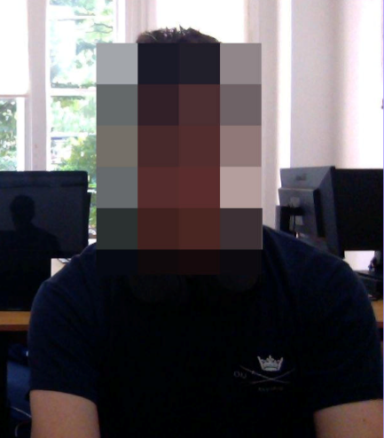
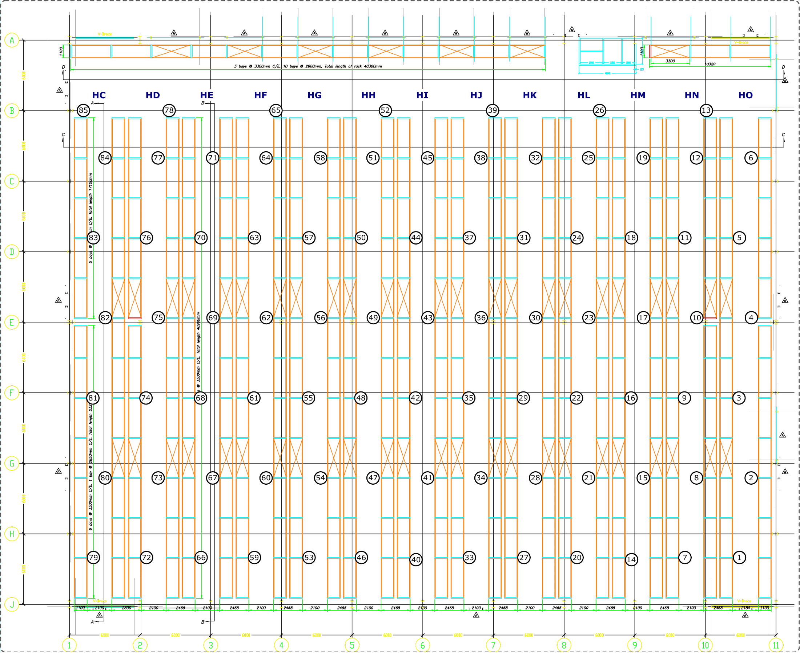

## Ethics Hub

This page provides information about ethics and data privacy in the Site-Driven Robotics (SiDR) project, with particular focus on the collection and use of personal data.

## Project Goal

SiDR is a research strand within the Mobile Robotics Group at the Oxford Robotics Institute, part of the Engineering Science Department of the University of Oxford. It brings together robotics, machine learning, computer vision, the Internet of Things, safety, and smart-building research. The project examines how existing structures, sensing and computing resources, operational processes, and site rules in established buildings can support the safe deployment of robots in spaces shared with people.

The research involves data collection and robot deployments in shared indoor spaces. Its aims are to:

- collect real-world data on how people use spaces during normal operations, using sensors such as cameras mounted on robots or fixed infrastructure;
- analyse recordings to understand movement within those spaces, including people’s positions and speeds;
- investigate how long-term robot operations can be improved and how they may affect the use of shared spaces.

This specific project with Gompels will not conduct robotic operations at this time but will only record the dataset mentioned above.

The sections below set out the project’s privacy notice and further information about how data is handled.

## Privacy Notice

A core part of SiDR involves collecting real-world datasets that capture how people use shared spaces and how robots operate within them. We collect this data through sensors mounted on robots and within the environment. These may include standard cameras, laser sensors, and fixed cameras. We use these datasets to study how people interact with their environment and to improve the safety, reliability, and robustness of robotic systems operating near people.

We select sensors and their locations to support safe robot operation and useful research. The work takes place in clearly defined indoor areas, which will be clearly marked while recording or robot operations are underway. In this specific project, we will not conduct robotic operations at this time but will only record the dataset mentioned above.

We will provide notice of data collection in several ways:

- We will place high-visibility signs at the boundaries of the operational area. These signs will link to this privacy notice.
- A printed copy of this privacy notice will be available at the site reception. It will also include site-specific information about the robots and the locations of fixed sensors.
- We will issue a notice at least one week before recording begins. This will contain the same information as the document at the site reception.

Images and video may incidentally record personal information, such as faces. However, SiDR datasets focus on general objects, situations, and movement patterns. The research does not focus on named individuals or sensitive personal information. SiDR does not conduct research on biometric identification, including facial recognition. Before data is shared with researchers for analysis, an authorised member of the research team will blur or pixelate faces and, where appropriate, other features that could identify a person.

The University of Oxford is the data controller with respect to your personal data, and as such will determine how your personal data is used in the research. The University will process your personal data for the purpose of the research outlined above. Research is a task that is performed in the public interest. Further information about your rights with respect to your personal data is available from the University’s Information Compliance website at [https://www.ox.ac.uk/about/how-we-are-run/policies-and-statements/policy-hub/research-data](https://www.ox.ac.uk/about/how-we-are-run/policies-and-statements/policy-hub/research-data).

### How is the data processed?

SiDR uses sensor data for non-commercial scientific research. This may include video, images, and laser-sensor data. Researchers use the data to develop computer programs that extract useful information from images, video, and three-dimensional point clouds. The research focuses on tasks such as:

- mapping and understanding indoor environments;
- detecting objects and people within those environments;
- identifying or predicting situations that may create a safety risk for future robotics operations.

For example, researchers may create a three-dimensional model of a building and detect the location – but not the identities – of people and objects within it. This helps the project understand how robots can operate safely in that space. SiDR systems are not designed to identify people or infer sensitive personal characteristics. They may detect that a person is present in an image or estimate body pose, such as the location of limbs in two- or three-dimensional space, or how they move from one room to another. They do not identify the person or determine personal characteristics.

### Why is the data processed?

The project requires custom datasets and real-world robot deployments to conduct its research. Existing datasets or simulation systems often do not reflect the buildings, layouts, processes, and safety needs of the spaces in which robots will operate. The data allows researchers to develop, test, and assess robot behaviours in the intended environment. This work supports research into safer and more reliable robots for shared spaces.

### What data is recorded at Gompels

At Gompels, we will record CCTV footage from the custom cameras installed in the warehouse. You can find a map of such cameras below.

<figure>
  
  <figcaption><a href="camera-plan.webp">View the camera location plan at full size.</a></figcaption>
</figure>

**Planned recording period: December 2026 to January 2027.**

We will record data during normal warehouse operations. This system will not interfere with typical operations, and you will not need to perform any actions or processes beyond what you normally do.

We will not conduct robotic operations at this time but will only record the dataset mentioned above. This data will be used to understand how people use and move through the spaces to develop more reliable robots capable of sharing spaces and tasks with humans in the future. As stated, none of this data will contain personal information, as we pseudonymise your identities by pixelating your faces. Additionally, no data will be shared with Gompels Healthcare Ltd under normal circumstances, unless required by law, such as for understanding an accident or if a criminal activity is detected.

### Who is using the data?

The data is used by researchers affiliated with the SiDR project and, more broadly, with the Oxford Robotics Institute. In addition to the PI, these are usually doctoral students, postdoctoral researchers, and technical staff sponsored by the project. In some cases, other researchers in our laboratory, universities, or research institutions may collaborate on parts of the research. In any case, only the masked data – i.e. where possible sources of identification have been blurred/deleted – will be made available for research, and only to approved personnel.

This project will be disseminated through academic publications, including conference papers, journal articles, and related presentations at national and international conferences. Similarly, part of this project will be included in students' theses.

Results and discussions on this work will be presented nationally and internationally at invited talks at conferences or to industrial partners. Similarly, materials (videos, flyers, blog posts, etc.) will be produced to promote the project and the Oxford Robotics Institute (ORI) in general. Finally, we intend to continue this line of work through additional funding. Thus, we will use the results from this project to apply for grant calls and engage potential stakeholders or private investors.

### What data is shared?

Only the principal investigator, authorised technical staff, and the system administrator may access raw data. These staff process raw data on an internal server within the University network. Before sharing data more widely, they remove or mask information that could identify a person, such as faces. The masking process uses locally run machine-learning tools.

Masked data may then be shared with approved researchers and technical staff working on SiDR, as described above.

Gompels Healthcare will not have routine access to research data. If researchers observe an immediate and serious risk to health and safety, they will stop or pause the relevant research activity where appropriate and report the matter promptly to the nominated Gompels Healthcare site contact. For non-urgent safety concerns, the team will make a factual record and discuss the matter with the PI, Daniele De Martini, who will seek advice from the relevant University teams where appropriate before deciding whether to raise it with the site contact. Any disclosure to the nominated Gompels Healthcare site contact or an appropriate authority will be lawful, necessary and proportionate, and the decision and its reasons will be documented.

### How to request data erasure

If you believe the project has collected identifiable personal data about you and you wish to request its erasure, please contact [daniele@robots.ox.ac.uk](mailto:daniele@robots.ox.ac.uk). The University will assess each request in line with applicable data-protection law and its obligations as a research institution. In some cases, it may not be possible to erase data where it has already been anonymised, incorporated into research results, or must be retained for legal or research-integrity reasons. Moreover, if you are concerned and would like to arrange reassignment to non-monitored areas, please check with your line manager to see if this is possible.

### Data retention

Identifiable raw data is stored in secure, encrypted local storage first at the company premises and then transferred to the university, with access limited to authorised personnel. Raw, non-pixelated video: retained only for as long as needed for technical validation, debugging, benchmarking, or investigation of a system fault. It will be deleted as soon as it is no longer needed and, in all cases, within one year of collection unless the PI or named data steward records and approves an exception. The de-identified data will be retained where needed for research analysis, verification of published findings and reproducibility during the project and for up to five years after the recorded project completion date. Any extension beyond the standard retention periods must be documented and approved by the PI – Daniele De Martini.

---

Ethics Application: Oxford UCSF — Inverted Automation: A New Paradigm for Hyper-low-cost, Scalable Warehouse Automation (ref. MS IDREC 3918063)

Version: 1.0  
Date: 01/11/2026
